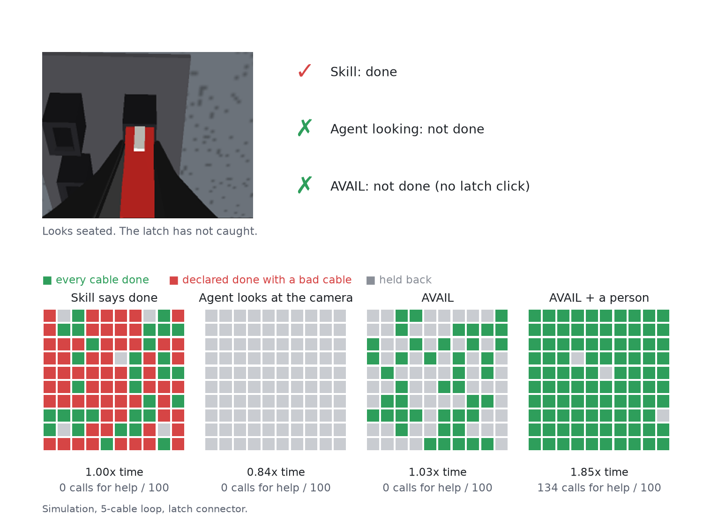

# AVAIL

A robot step is done when evidence says so.



In simulation, agentic robotics systems grade themselves with privileged truth: ASPIRE keeps the programs its
benchmark scores as successes, RPG practices against simulator checkers, and EmbodiedSWE grades against hidden rubrics
and trains only on verified outcomes. On a real robot that grader is gone. AVAIL is a grader you can take to the real
robot: physical checks with an error rate measured against sim truth, a person when it cannot tell, and every
intervention logged as labeled data, all outside the agent.

- [Use it with ASPIRE](docs/USE_WITH_ASPIRE.md): an MCP proxy between ASPIRE's agent and its robot tools that passes
  every tool through and adds `avail_verify`, `avail_probe`, `avail_ask_human` and `avail_done`.
- [Audit your success check](docs/AUDIT_YOUR_CHECK.md): give it the function that says "done" in your stack and get
  its pass rate on bad states, by failure type, with n and intervals.
- [Add a task](docs/ADD_A_TASK.md): 1 task file, 1 file per check, and a testbed module. The core does not change.

## Quickstart

Needs [uv](https://docs.astral.sh/uv/) and git. No GPU, no API key.

```bash
git clone <this repo> avail
cd avail
uv run python scripts/setup_aspire.py
uv run avail demo
```

The setup clones ASPIRE at the pinned commit into `third_party/ASPIRE` for its dual-YAM station model. The demo
injects 36 near-miss plugs in easy and hard mode, runs the free checks and writes an HTML report.

## Results

All rows are simulation, on test seeds read once. Rates carry a Wilson 95% interval, and bounds are one-sided 95%
Clopper-Pearson. [RESULTS.md](docs/RESULTS.md) has every table and [STATISTICS.md](docs/STATISTICS.md) the method.

| Measurement | n | Result |
|---|---|---|
| Sim: the skill's own done flag passes bad `latch` plugs | 1,170 | 80.1% (77.7 to 82.3) |
| Sim: the wrist camera check passes bad `latch` plugs | 1,170 | 15.1% (13.2 to 17.3) |
| Sim: a 3 mm tug passes bad `latch` near misses, hard mode | 200 | 2.0% (0.8 to 5.0) |
| Sim: a cheap VLM judge passes the same near misses | 200 | 17.5% (12.9 to 23.4) |
| Sim: AVAIL's cascade at alpha 2% accepts bad `latch` plugs, hard mode v2 | 1,111 | 0.5%, bound 1.06% |
| Sim: the same cascade sends `latch` claims to a person | 1,886 | 2.6% (2.0 to 3.4) |

| Sim: the skills alone declare a bad cable done, 5-cable `latch` loop | 1,000 cycles | 67.3% of cycles (64.3 to 70.1) |
| Sim: AVAIL with a simulated person declares a bad cable done, same loop | 5,000 cycles | 0.62% of cycles (0.44 to 0.88), bound 0.84% |
| Sim: what the person's help cost on that run | 5,000 cycles | 118.7 calls per 100 cycles, 1.81 times the cycle time |

The last 2 rows miss the bar set before the run, under 0.5% at 95%. Every bad cable that got through passed at the
release step, through a hand-set rule. The calibrated insertion check let none through in 6,000 cycles.

The figure is its own run: 100 cycles per grader on the same 100 new seeds, read once. The skill's own flag declared a
bad cable done in 64. A cheap VLM judge looking after every step held back all 100, because it said no to almost
everything. AVAIL alone declared none bad and finished 43, and AVAIL with a person finished 97 at 134 calls for help
per 100 cycles. [RESULTS.md](docs/RESULTS.md) has its table.

## What this does not show

- No real hardware yet. Every number is simulation. A real camera, connector and force estimate will be noisier.
- The person is simulated. It answers from truth and takes over with a scripted correction.
- ASPIRE's real server was not run. The proxy was tested against a mock built from ASPIRE's own tool definitions.
- The closed-loop judge is a cheap model. A stronger judge may pass fewer bad plugs and was not run in closed loop.
- The bounds hold for states like these: this station and this mix of failures.

## Credits

- The GR00T 2 whitepaper, for naming verification as an open problem.
- FailBench, for measuring it.
- EmbodiedSWE, for the finding that coding agents hack visible graders up to 43% of the time, and for rubric tests.
- Walden and Russ Tedrake's CoRL 2026 keynote, for the loop and the customer's bar.
- ASPIRE by NVIDIA, for the dual-YAM station model, read from a clone at setup time. See [NOTICE](NOTICE).

## License

Apache-2.0. See [LICENSE](LICENSE).
