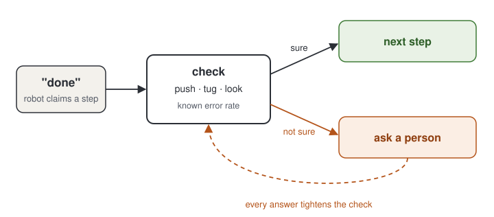

# How AVAIL works

Level 1: a skill claims a step is done, AVAIL gathers evidence, a calibrated check accepts, rejects or abstains, an
abstain goes to a person, and only an accept or a person's sign-off marks the step done.

## The loop

1. **Claim.** A skill finishes a step and says so: "plug 3 is in port B2". The claim names a predicate from the task
   file, such as `seated` or `latched`. A claim is a request for a verdict, and it never marks anything done itself.
2. **Evidence.** Each evidence source reads what a robot has: joint readings, gripper width, force estimate, the
   wrist and fixed cameras, a link signal. Probes act on the world through the robot's own motion tools: a push, a
   tug of a few mm, a wiggle. Every source returns numbers and never sees simulator truth.
3. **Calibrated check.** A witness turns the evidence into 1 of 3 verdicts. It is a cascade of stages in order of
   cost (passive signals, then the camera, then a push, then a tug, then a look). Each stage has an accept and a
   reject threshold, set on calibration states with known truth so that the chance of accepting a bad state is at
   most a chosen alpha. When no stage is sure, the witness abstains.
4. **Fork.** A reject with tries left goes back to the skill. A reject with no tries left, or an abstain, goes to a
   person with a handoff: what was claimed, what each source said, and the frames. The person confirms, rejects, or
   takes over and fixes it.
5. **Done gate.** A step is done only with an accept verdict or a person's sign-off. No argument of any tool can
   mark a step done, and a test checks that no function accepts free text as a decision.
6. **Ledger and exports.** Every claim, evidence value, verdict, question and takeover is 1 record. A person's answer
   is a calibration label. A takeover's frames are a correction demo, exported LeRobot-style with every frame tagged
   autonomous or assisted.

## The parts

| Part | Where | What it is |
|---|---|---|
| Core | `avail/core`, `schemas`, `ledger`, `stats`, `witness`, `fork`, `flywheel`, `shift` | Claim, verdict, fork, gate, records. Imports no simulator and names no task |
| Task | `tasks/*.yaml` | Items, steps, predicates in plain words, which checks serve each predicate |
| Checks | `avail/evidence` | 1 file per evidence source |
| Testbed | `avail/station/mj_plug` | A MuJoCo plug and cable station on ASPIRE's dual-YAM model, with 9 injected failure types and truth behind a wall |
| Agent side | `avail/agent` | An MCP server and an MCP proxy that put the gate between an agent and its robot tools |
| Audit | `avail/audit.py` | Scores any success check on the near-miss zoo |

## The truth wall

The simulator knows whether each plug is seated. Only the zoo generator, the scorer and the simulated person may read
that. Evidence sources, witnesses and the fork never see it, and `tests/test_truth_wall.py` fails the suite if one
does. This is what makes a measured error rate mean something: the check was scored against truth it could not read.
