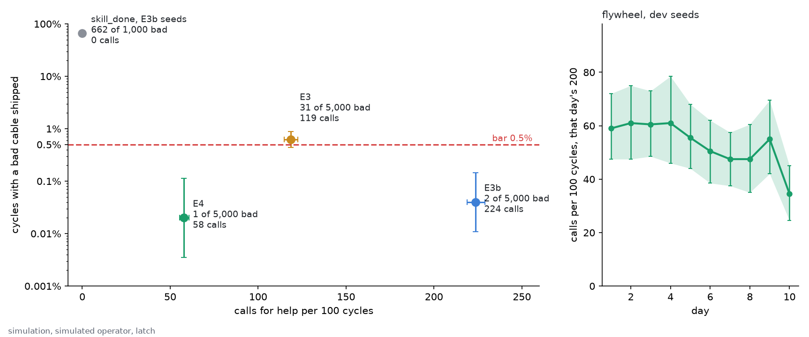

# Results

Level 1: in simulation, a skill's own done flag passes about 80% of bad plugs, a tug passes about 2%, a cheap VLM
judge 18% to 32%, and AVAIL's calibrated cascade under 1%, asking a person about 3% of the time. On a 5-cable loop with
a simulated operator, AVAIL shipped a bad cable in 31 of 5,000 cycles in E3 and, after its checks were fixed, in 2 of
5,000 in E3b, at 223.6 calls for help per 100 cycles. E4, the code here, shipped 1 in 5,000 at 57.8 calls.

Every number on this page is simulation, from the plug and cable station in `avail/station/mj_plug`, scored against
truth the checks never read. Test seeds were read once. Rates carry a Wilson 95% interval, and bounds are one-sided
95% Clopper-Pearson.

## The station

A simulated dual-arm YAM (ASPIRE's station model) plugs a friction connector (`fric`) and a latching connector
(`latch`) into a board of 8 sockets. 9 failure types are injected next to good plugs: 0.5 to 1 mm short, 1 to 2 mm
short, 2 to 4 mm short, at the mouth only, unlatched, wrong port, tilted jam, dropped, and not released. Easy mode renders clean scenes
with exact joint readings. Hard mode adds a 1080p fisheye wrist webcam, jams no capped push passes, a drifting force
estimate and connector lots. Hard mode v2 adds SO-101-class servo readings: a 4,096-count encoder, gear lash and
current in counts.

## Single checks on bad plugs (easy mode, sim)

Each check tuned on calibration seeds to accept 95% of good plugs, then scored on the test seeds.

| Check, sim | `fric`: bad plugs passed | `latch`: bad plugs passed |
|---|---|---|
| The skill's own done flag | 79.3% (891 of 1,124, 76.8 to 81.5) | 80.1% (937 of 1,170, 77.7 to 82.3) |
| Camera, wrist view | 0.3% (3 of 1,124, 0.1 to 0.8) | 15.1% (177 of 1,170, 13.2 to 17.3) |
| All passive signals, fused | 0.0% (0 of 1,124, bound 0.27%) | 0.0% (0 of 1,170, bound 0.26%) |

Each single check is blind to a different failure. The camera cannot see whether a latch caught, so an unlatched plug
passes it. The click and the tug cannot tell the wrong port from the right one. Fused, they cover each other.

## The cascade at alpha 2% (sim)

| Mode, sim | `fric`: bad plugs accepted | `latch`: bad plugs accepted | Claims sent to a person |
|---|---|---|---|
| Easy | 0 of 1,124 (bound 0.27%) | 0 of 1,170 (bound 0.26%) | 1 of 3,769 |
| Hard | 1 of 1,223 (bound 0.39%) | 5 of 1,155 (bound 0.91%) | 0 of 3,742 |
| Hard v2 | 3 of 1,156 (bound 0.67%) | 6 of 1,111 (bound 1.06%) | `fric` 4.0% (75 of 1,880, 3.2 to 5.0), `latch` 2.6% (49 of 1,886, 2.0 to 3.4) |

In v2 1 encoder count moves the tool about 0.6 mm, so the click detector fires on short plugs as often as on good
ones. The cascade then leans on the camera for `fric` and on the tug for `latch`, and asks a person more often.

## VLM judges against the tug (hard mode near misses, sim)

The judges read the stored claim frames of 200 hard-mode near misses per connector, the same states the tug was
scored on.

| Check, sim | `fric`: bad passed | `latch`: bad passed | Good plugs passed |
|---|---|---|---|
| Tug | 1.5% (3 of 200, 0.5 to 4.3) | 2.0% (4 of 200, 0.8 to 5.0) | 94.9% `fric`, 96.4% `latch` |
| Camera check | 6.5% (13 of 200, 3.8 to 10.8) | 34.5% (69 of 200, 28.3 to 41.3) | 95.7% `fric`, 95.1% `latch` |
| Nex N2.5 mini, open weights, best prompt | 31.5% (63 of 200, 25.5 to 38.2) | 17.5% (35 of 200, 12.9 to 23.4) | about 30%, on 44 and 48 exploratory good plugs |
| GPT-6 Luna, cheap closed | 0.0% (0 of 200) | 1.0% (2 of 200, 0.3 to 3.6) | 0 of 44 and 0 of 48 exploratory good plugs |
| Claude Fable 5.2, crop with a reference | 68.1% (92 of 135, 59.9 to 75.4) | 91.9% (124 of 135, 86.0 to 95.4) | not measured |

Luna's low rate comes from saying no to almost every plug, good ones too.

## The cable loop (sim)

A cycle picks 5 cables from a rack and plugs each into its assigned `latch` port. Arms: `flag` (`skill_done` in E3b)
trusts each skill's own done, `avail` gates each step and never asks, `avail_simop` gates each step and calls a
simulated operator when its checks and recovery do not settle the step. E3 recorded that arm under its old name,
`avail_human`. The simulated operator
answers from truth and takes over with a scripted correction. A cycle ships a bad cable when it ends declared done
while a cable is not seated, latched and let go in its assigned port.

### E3: the certification run (sim, `latch`, test seeds read once)

The bar, written before the run: certify under 0.5% of cycles with a bad cable declared done, at 95%. With 5,000
cycles that allows at most 16.

| Sim, E3 | `flag` | `avail` | `avail_simop`, recorded as `avail_human` |
|---|---|---|---|
| Cycles | 1,000 | 1,000 | 5,000 |
| Cycles with a bad cable declared done | 67.3% (673, 64.3 to 70.1) | 0.6% (6, 0.3 to 1.3) | 0.62% (31, 0.44 to 0.88), bound 0.84% |
| Cycles with every cable done | 29.2% (292) | 38.9% (389) | 97.9% (4,896) |
| Calls for help per 100 cycles | 0 | 0 | 118.7 |
| Seconds per cycle | 87 | 91 (1.05x) | 157 (1.81x) |

The operator arm missed the bar: 31 against at most 16. All 37 bad cables on the 2 AVAIL arms passed at the release
step, through a hand-set rule with no calibrated bound. The calibrated insertion check let no bad insertion through in
6,000 cycles. E3b below is the 1 retest, after the release check and the other 2 hand-set checks were calibrated.

### E3b: the retest (sim, `latch`, new test seeds read once)

After E3 and before any E3b seed was read, the 3 hand-set checks became witnesses calibrated the way the insertion's
is, fit on `check_fit` and calibrated on `check_calibration` (`avail/station/mj_plug/check_zoo.py`). `at_port` also
reads the board's offset as the robot measured it (`passive.hover_offset`). `released_stable` reads the jaws, the
release record, the lift's forces and the camera, then ends with a pull (`probe.release_tug`): the jaws close on the
released plug again and pull it below the latch's hold, which a latched plug holds. On calibration (in sample, alpha
0.01) `held`, `at_port` and `released_stable` sent 5.0%, 5.3% and 3.6% of good claims to the operator. Without the
pull the release check had sent 94.5%. The bar stayed the same: at most 16 of 5,000 cycles. E3b read seeds 80,000 to
84,999 once, on 2026-11-14, with `skill_done` on the 1st 1,000 of them.

| Sim, E3b, 2026-11-14 | `skill_done` | `avail_simop` |
|---|---|---|
| Cycles | 1,000 | 5,000 |
| Cycles with a bad cable shipped | 66.2% (662, 63.2 to 69.1) | 0.04% (2, 0.01 to 0.15), bound 0.13% |
| Calls for help per 100 cycles | 0 | 223.6 |
| Seconds per cycle | 87 | 219 (2.53x) |

`avail_simop` met the bar: 2 against at most 16. Both bad cables passed the release check after an insertion that let
go early. The cost was description only, as written before the run: 223.6 calls for help per 100 cycles (E3: 118.7),
219 s per cycle (E3: 157 s) and 2.2 robots per operator (E3: 2.7), where robots per operator is the cycle time over
the operator's answering and handling time per cycle. The pull adds 18.4 s of checks per cycle. The carry made 54% of
the calls: a cable cocked in the jaws stays cocked when the carry is tried again. The 2 runs are not 2 tests of 1
system. E3b's checks were changed after E3 failed, and it ran on new seeds. E3's failure stays on record.

E3 and E3b ran before the recovery ladder that is in the code now (`fork.ladder` in `tasks/cable_loop.yaml`). In both,
a rejected step was retried once, and an uncertain step or a 2nd reject went to the operator. E4 below tests the
ladder together with 3 other changes.

### E4: the same bar at a quarter of E3b's calls (sim, `latch`, new test seeds read once)

E4 asked whether the bar holds at a cost a deployment would accept. Written before the run: H4a, `avail_simop` ships a
bad cable in under 0.5% of cycles at 95% (at most 16 of 5,000), and H4b, the one-sided 95% upper bound on its calls
for help per 100 cycles, from a bootstrap over cycles, is at most 112, half of E3b's 224. Both had to pass. 4 things
changed after E3b, all chosen on dev and calibration seeds. The release pull got 2 features that tell a pull that
stalled from one that held. `held` and `released_stable` got alphas from an error budget whose union bound is 0.477%
per cycle, `at_port` got 0.025, the alpha with the fewest claims sent to the operator plus bad claims passed on, and
the insertion check kept 0.01. Where a stage's 2 thresholds cross, the pick, carry and release checks now accept
above their accept threshold, where E3b's abstained between the 2. The insertion check keeps that abstain. And after
the last reject of a carry or an insertion, or an abstain, the robot regrips a cable that hangs crooked over its port
or reinserts the plug, and the same check decides again on a fresh claim. The pick and the release have no such
action after a reject, so they call after their 2nd try as before. A 1st gate on dev seeds failed
with 2 bad cycles in 154, both after a 4th recovery action that pushed the released plug home. That action was
dropped, 2 bugs were fixed, 2 other recovery changes were made (a 2nd look at a held cable only after an abstain, and
the regrip carrying through the stand-in's waypoint), and a 2nd gate on 500 fresh dev cycles passed. E4 read seeds
40,000 to 44,999 once, on 2026-11-16, with `skill_done` on the 1st 1,000 of them. The code in this repository is
the code E4 ran, except the demo's fresh-clone setup and the figure script.

| Sim, E4, 2026-11-16 | `skill_done` | `avail_simop` |
|---|---|---|
| Cycles | 1,000 | 5,000 |
| Cycles with a bad cable shipped | 65.4% (654, 62.4 to 68.3) | 0.02% (1, 0.004 to 0.11), bound 0.095% |
| Calls for help per 100 cycles | 0 | 57.8, bound 60.2 |
| Seconds per cycle | 87 | 160 (1.85x) |
| Robots per operator | no operator | 4.8 |

Both passed: 1 bad cycle against at most 16, and a bound of 60.2 calls against 112. 1 operator covers 4.8 robots
(E3b 2.2), and takeovers came at 43.9 per 100 cycles. The 4 changes ran together, so E4 cannot say which one cut the
calls. Before a call, the plain 2nd try turned 2,837 truly failed steps into accepted good ones, and the rungs 2,208
more (1,173 regrips and 1,035 reinserts that made a bad step good and were accepted). Neither rung made a good step
bad. The checks could not decide 4 times in 5,000 cycles, all on good insertions, and the reinsert settled each, so
the operator was never asked to confirm. E3b had made 73.3 calls per 100 cycles after an abstain.

The 1 bad cable followed a stuck release. The fingers did not open on the 1st try, and the 20 mm lift pulled the
latched plug with the jaws closed until the latch gave, twice. The release check rejected that try. The retry opened
the jaws while the arm was still springing up, and the plug fell 32 mm beside its port. The release check's 1st stage,
a logistic score over the jaws, the release record, the lift's forces and the camera, accepted it before the pull. The
camera's 64 degree slant and the opening height on record, 79.7 mm and read mid-spring, pushed the score up. Each sits
at the top of the 216 bad claims of that kind in its calibration table, all of which it rejected, and no row of its
tables holds the 2 together. Both bad cycles of the failed gate came the same way, after the dropped action: a stuck
release, the camera without the plug and a steep slant, and a stage-1 accept. That makes 3 occurrences, a pattern to
fix. E3b's 2 bad cables came another way: the pull stalled and was read as a hold. E4 had no bad release whose pull
stalled. Scored again on their recorded evidence, the check here rejects 1 of E3b's 2 stalls and still accepts the
other. On both the camera found neither housing nor plug and the pull did not slip, so 17 readings are absent, as on
E4's own claims of that kind, and the check fills them with its fit medians as it does live.

Where the calls came from: the release 27.5 per 100 cycles, the carry 22.7, the insertion 6.8 and the pick 0.7. Of
the release's 1,377 calls, 518 came after it rejected a good release twice and 23 after it rejected a good retry of a
stuck release: it rejected every good 2nd try (541 of 541). It weighs a 2nd release try heavily toward bad, since in
its tables a 2nd try followed only a 1st that truly failed, and 480 of the 485 in its calibration table were bad. The
790 cables with a stuck release drew 814 of the release's calls.

### The figure run (sim, `latch`, 100 new test seeds read once)

100 cycles per arm on seeds 72,000 to 72,099, the same seeds for every arm. `agent_looks` is an agent checking its own
work by looking: after every step a VLM judge (GPT-6 Luna, the cropped view after a seated reference, the robot's
readings in the prompt, reasoning off) sees the step's frames, and its yes or no decides, with 2 tries.

| Sim, figure run | Skill says done | Agent looks at the camera | AVAIL | AVAIL + simulated operator |
|---|---|---|---|---|
| Every cable truly done | 31 | 0 | 43 | 97 |
| Declared done with a bad cable | 64 (54.2 to 72.7) | 0 | 0 (bound 3.0%) | 0 (bound 3.0%) |
| Held back | 5 | 100 | 57 | 3 |
| Time per cycle (x skill) | 1.00 | 0.84 | 1.03 | 1.85 |
| Calls for help per 100 cycles | 0 | 0 | 0 | 134 |

The judge was chosen by its S4c record: the non-Fable judge with the best balanced accuracy on hard-mode near misses,
since none passed 80% of good plugs. It said yes to 123 of 883 picks, 1 of 246 carries and 0 of 2 insertions, so it
held back every cycle, and its time is short because it stopped early. Its calls cost about $0.20. In the top panel it
says not done about a bad plug, which is right, and it says the same about good ones. The 64 red cycles and the 0 on
both AVAIL arms are the comparison that carries over. 100 cycles cannot show a rate under about 3%: E3 above is the
large run.
