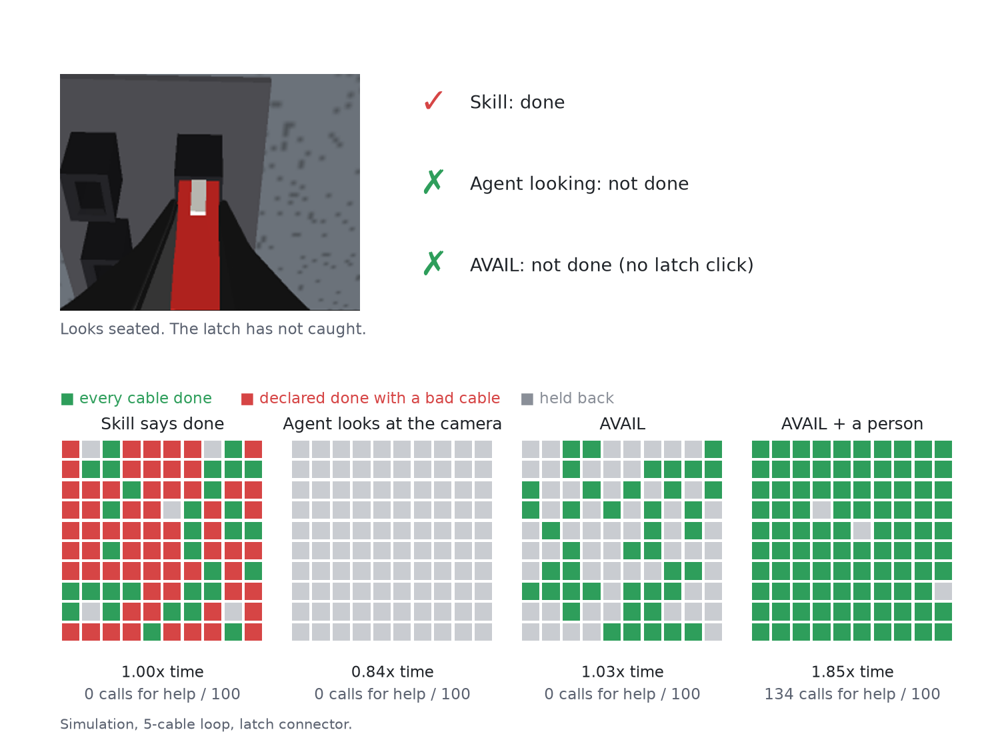

# Results

Level 1: in simulation, a skill's own done flag passes about 80% of bad plugs, a tug passes about 2%, a cheap VLM
judge 18% to 32%, and AVAIL's calibrated cascade under 1%, asking a person about 3% of the time.

Every number on this page is simulation, from the plug and cable station in `avail/station/mj_plug`, scored against
truth the checks never read. Test seeds were read once. Rates carry a Wilson 95% interval, and bounds are one-sided
95% Clopper-Pearson.

## The station

A simulated dual-arm YAM (ASPIRE's station model) plugs a friction connector (`fric`) and a latching connector
(`latch`) into a board of 8 sockets. 9 failure types are injected next to good plugs: 0.5 to 1 mm short, 1 to 2 mm
short, 2 to 4 mm short, at the mouth only, unlatched, wrong port, tilted jam, dropped, and not released. Easy mode renders clean scenes
with exact joint readings. Hard mode adds a 1080p fisheye wrist webcam, jams no capped push passes, a drifting force
estimate and connector lots. Hard mode v2 adds SO-101-class servo readings: a 4,096-count encoder, gear lash and
current in counts.

## Single checks on bad plugs (easy mode, sim)

Each check tuned on calibration seeds to accept 95% of good plugs, then scored on the test seeds.

| Check, sim | `fric`: bad plugs passed | `latch`: bad plugs passed |
|---|---|---|
| The skill's own done flag | 79.3% (891 of 1,124, 76.8 to 81.5) | 80.1% (937 of 1,170, 77.7 to 82.3) |
| Camera, wrist view | 0.3% (3 of 1,124, 0.1 to 0.8) | 15.1% (177 of 1,170, 13.2 to 17.3) |
| All passive signals, fused | 0.0% (0 of 1,124, bound 0.27%) | 0.0% (0 of 1,170, bound 0.26%) |

Each single check is blind to a different failure. The camera cannot see whether a latch caught, so an unlatched plug
passes it. The click and the tug cannot tell the wrong port from the right one. Fused, they cover each other.

## The cascade at alpha 2% (sim)

| Mode, sim | `fric`: bad plugs accepted | `latch`: bad plugs accepted | Claims sent to a person |
|---|---|---|---|
| Easy | 0 of 1,124 (bound 0.27%) | 0 of 1,170 (bound 0.26%) | 1 of 3,769 |
| Hard | 1 of 1,223 (bound 0.39%) | 5 of 1,155 (bound 0.91%) | 0 of 3,742 |
| Hard v2 | 3 of 1,156 (bound 0.67%) | 6 of 1,111 (bound 1.06%) | `fric` 4.0% (75 of 1,880, 3.2 to 5.0), `latch` 2.6% (49 of 1,886, 2.0 to 3.4) |

In v2 1 encoder count moves the tool about 0.6 mm, so the click detector fires on short plugs as often as on good
ones. The cascade then leans on the camera for `fric` and on the tug for `latch`, and asks a person more often.

## VLM judges against the tug (hard mode near misses, sim)

The judges read the stored claim frames of 200 hard-mode near misses per connector, the same states the tug was
scored on.

| Check, sim | `fric`: bad passed | `latch`: bad passed | Good plugs passed |
|---|---|---|---|
| Tug | 1.5% (3 of 200, 0.5 to 4.3) | 2.0% (4 of 200, 0.8 to 5.0) | 94.9% `fric`, 96.4% `latch` |
| Camera check | 6.5% (13 of 200, 3.8 to 10.8) | 34.5% (69 of 200, 28.3 to 41.3) | 95.7% `fric`, 95.1% `latch` |
| Nex N2.5 mini, open weights, best prompt | 31.5% (63 of 200, 25.5 to 38.2) | 17.5% (35 of 200, 12.9 to 23.4) | about 30%, on 44 and 48 exploratory good plugs |
| GPT-6 Luna, cheap closed | 0.0% (0 of 200) | 1.0% (2 of 200, 0.3 to 3.6) | 0 of 44 and 0 of 48 exploratory good plugs |
| Claude Fable 5.2, crop with a reference | 68.1% (92 of 135, 59.9 to 75.4) | 91.9% (124 of 135, 86.0 to 95.4) | not measured |

Luna's low rate comes from saying no to almost every plug, good ones too.

## The cable loop (sim)

A cycle picks 5 cables from a rack and plugs each into its assigned `latch` port. Arms: `flag` trusts each skill's
own done, `avail` gates each step and never asks, `avail_human` gates each step and asks a simulated person when it
cannot tell. The simulated person answers from truth and takes over with a scripted correction.

### E3: the certification run (sim, `latch`, test seeds read once)

The bar, written before the run: certify under 0.5% of cycles with a bad cable declared done, at 95%. With 5,000
cycles that allows at most 16.

| Sim, E3 | `flag` | `avail` | `avail_human` |
|---|---|---|---|
| Cycles | 1,000 | 1,000 | 5,000 |
| Cycles with a bad cable declared done | 67.3% (673, 64.3 to 70.1) | 0.6% (6, 0.3 to 1.3) | 0.62% (31, 0.44 to 0.88), bound 0.84% |
| Cycles with every cable done | 29.2% (292) | 38.9% (389) | 97.9% (4,896) |
| Calls for help per 100 cycles | 0 | 0 | 118.7 |
| Seconds per cycle | 87 | 91 (1.05x) | 157 (1.81x) |

`avail_human` missed the bar: 31 against at most 16. All 37 bad cables on the 2 AVAIL arms passed at the release
step, through a hand-set rule with no calibrated bound. The calibrated insertion check let no bad insertion through in
6,000 cycles. A calibrated check for the release is the next piece of work.

### The figure run (sim, `latch`, 100 new test seeds read once)

100 cycles per arm on seeds 72,000 to 72,099, the same seeds for every arm. `agent_looks` is an agent checking its own
work by looking: after every step a VLM judge (GPT-6 Luna, the cropped view after a seated reference, the robot's
readings in the prompt, reasoning off) sees the step's frames, and its yes or no decides, with 2 tries.

| Sim, figure run | Skill says done | Agent looks at the camera | AVAIL | AVAIL + a person |
|---|---|---|---|---|
| Every cable truly done | 31 | 0 | 43 | 97 |
| Declared done with a bad cable | 64 (54.2 to 72.7) | 0 | 0 (bound 3.0%) | 0 (bound 3.0%) |
| Held back | 5 | 100 | 57 | 3 |
| Time per cycle (x skill) | 1.00 | 0.84 | 1.03 | 1.85 |
| Calls for help per 100 cycles | 0 | 0 | 0 | 134 |

The judge was chosen by its S4c record: the non-Fable judge with the best balanced accuracy on hard-mode near misses,
since none passed 80% of good plugs. It said yes to 123 of 883 picks, 1 of 246 carries and 0 of 2 insertions, so it
held back every cycle, and its time is short because it stopped early. Its calls cost about $0.20. In the top panel it
says not done about a bad plug, which is right, and it says the same about good ones. The 64 red cycles and the 0 on
both AVAIL arms are the comparison that carries over. 100 cycles cannot show a rate under about 3%: E3 above is the
large run.
