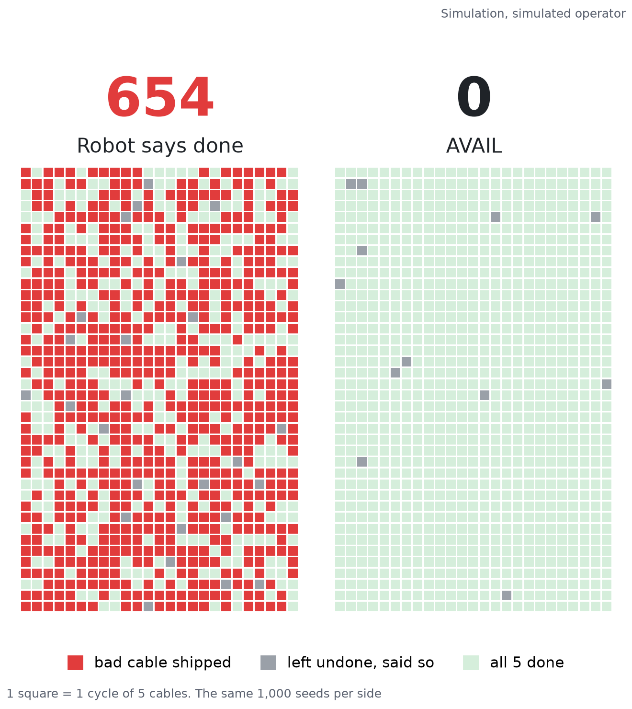
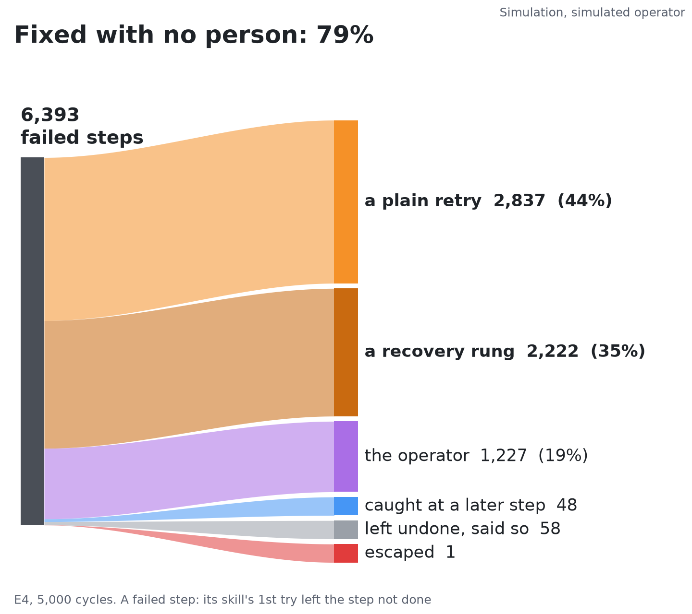
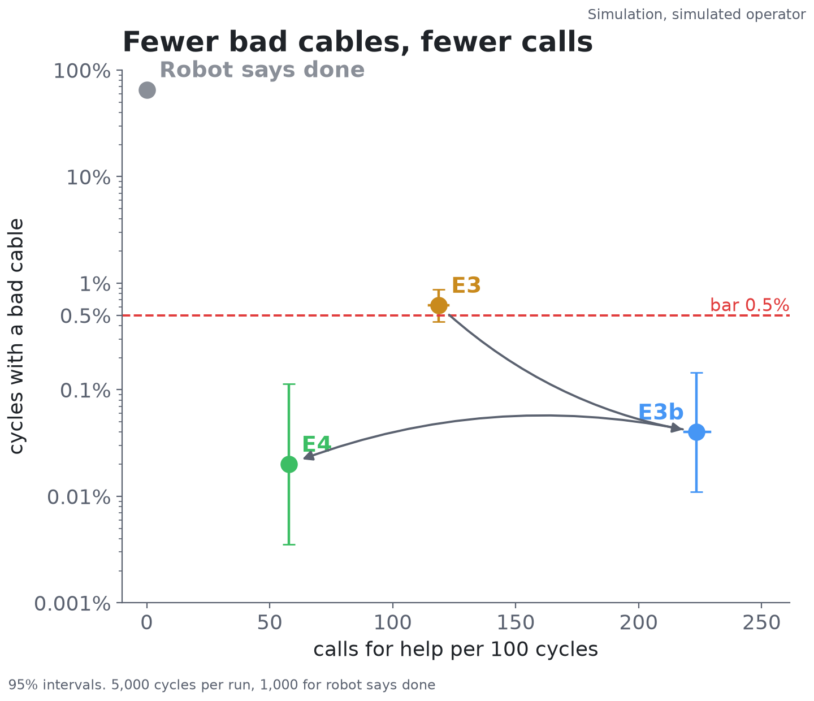

# Visuals

Each picture makes 1 point. All 6 come from ledgers on disk through 1 script, and all are simulation with a simulated operator. Run it again when a new run lands:

```powershell
uv run python -m avail.analysis.visuals
```



On the same 1,000 simulated cycles of E4, the robot's own "done" shipped a bad cable in 654 and AVAIL in 0, and AVAIL left a cable undone and said so in 12.



Of E4's 6,393 steps whose skill failed on its 1st try, 79% were put right with no person (a plain retry or a recovery rung), 19% by the operator, and 1 escaped.


E4's cycles replayed on 5 robots for 1 hour keep 1 operator busy 84% of the hour, and the robots wait 43 minutes in all for their turn, with each call costing the operator its time to answer plus handling, as in robots per operator.



From E3 to E4 the cycles with a bad cable fell from 0.62% to 0.02% and the calls for help from 119 to 58 per 100 cycles, against 65% bad for the robot's own "done".


Each claim a check caught is a labeled failure with its wrist frame, and E4 made 2,118 of them per 1,000 cycles (the frames come from a dev run of E4's setup, since a test seed's station is never built again).


The showcase cycle run twice on dev seed 20,201: the robot's own "done" ships cables 1 and 4 bad, and AVAIL, as E3 ran it in the film, ends with all 5 done.
