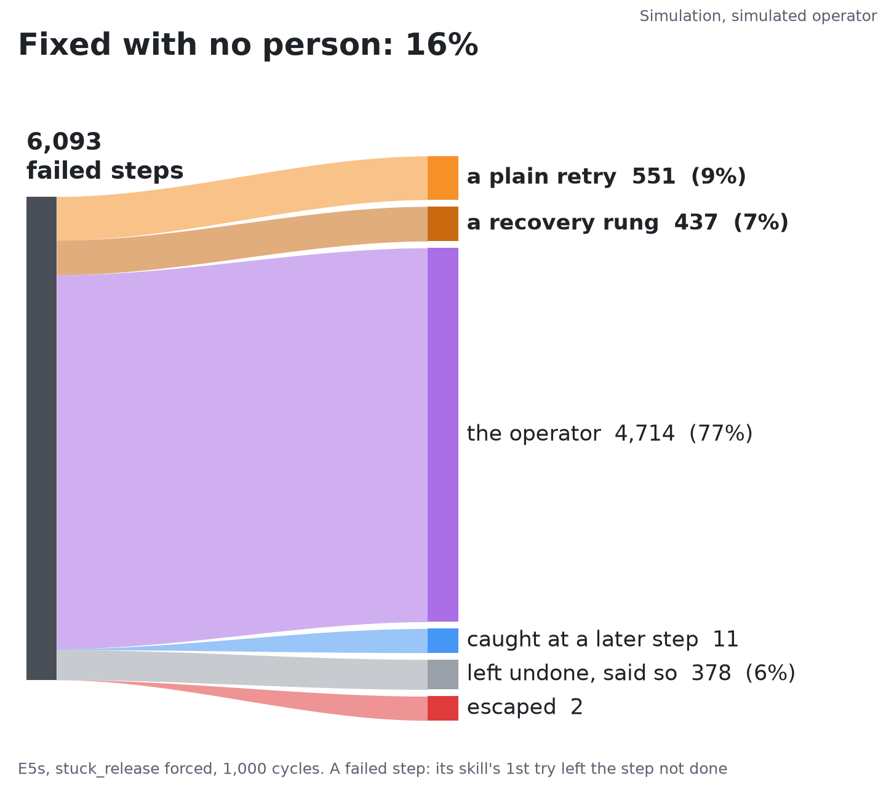
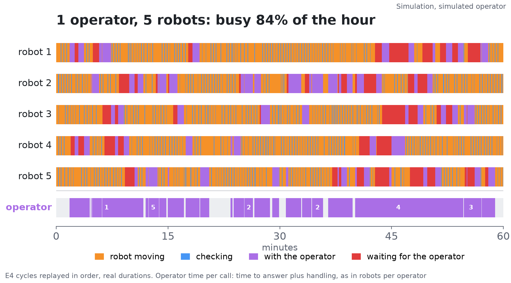
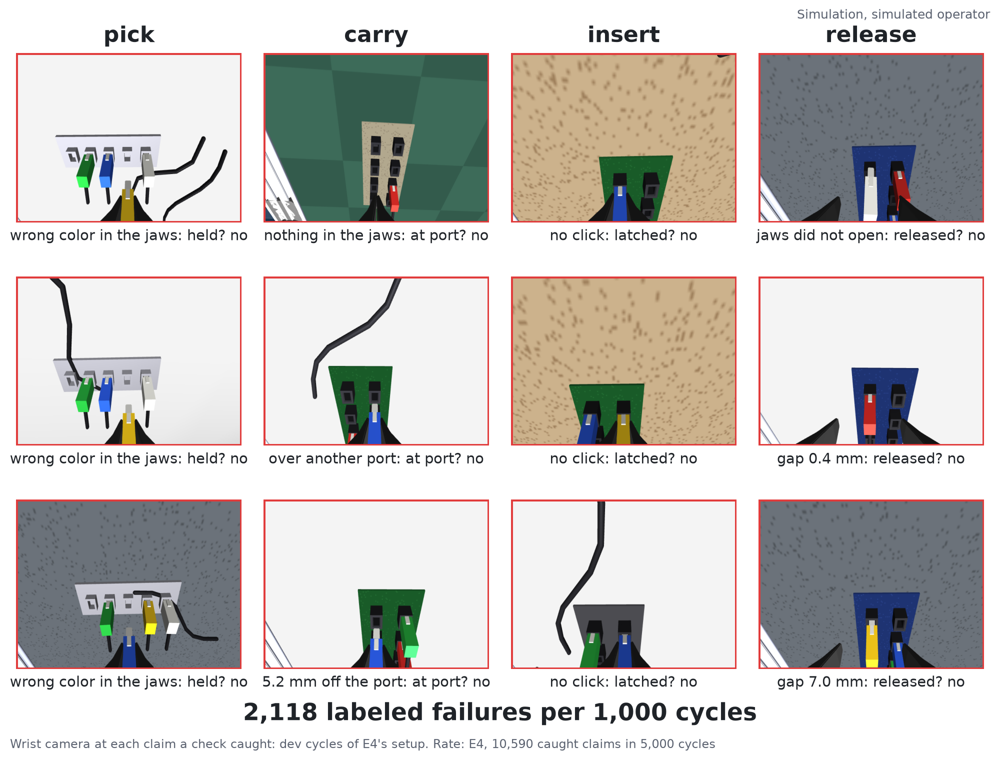
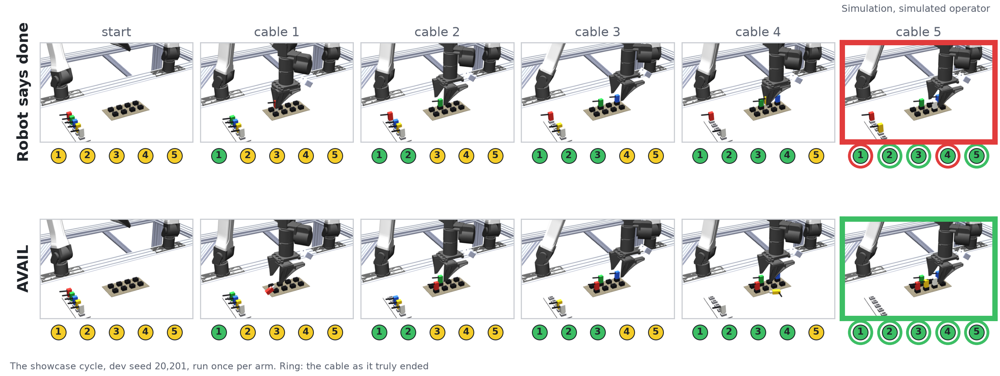
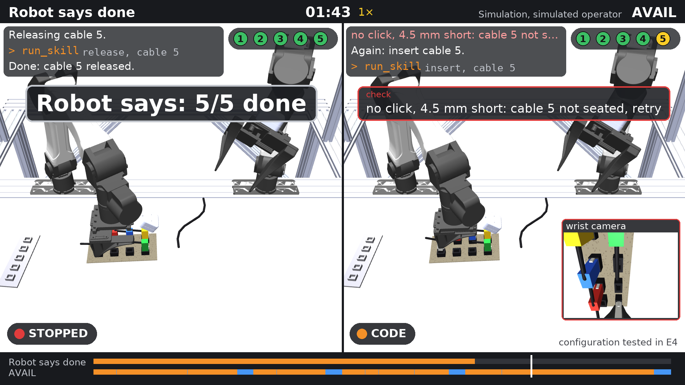
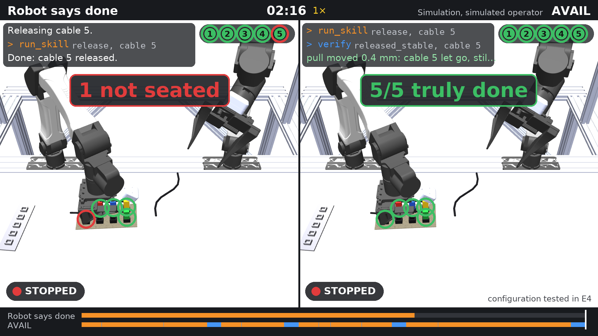
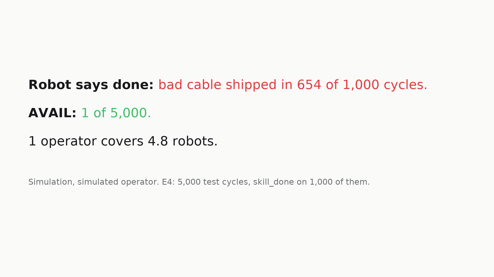
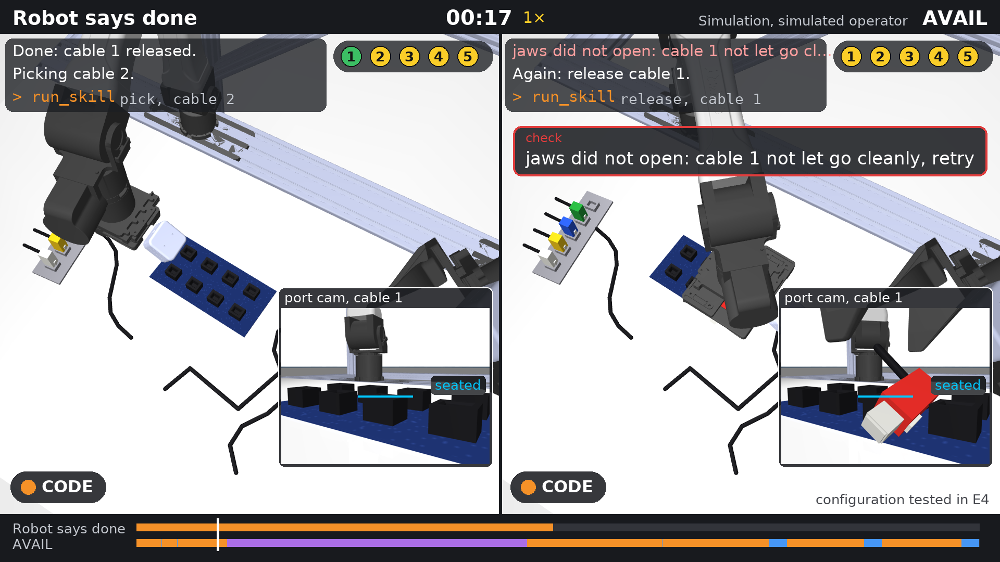
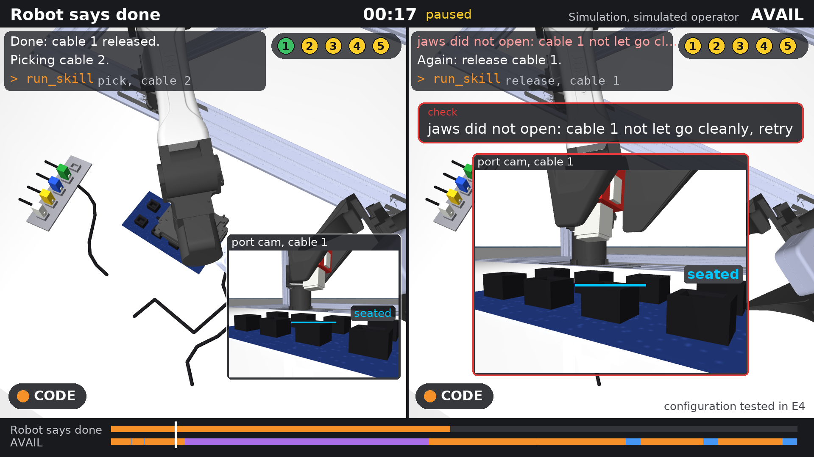
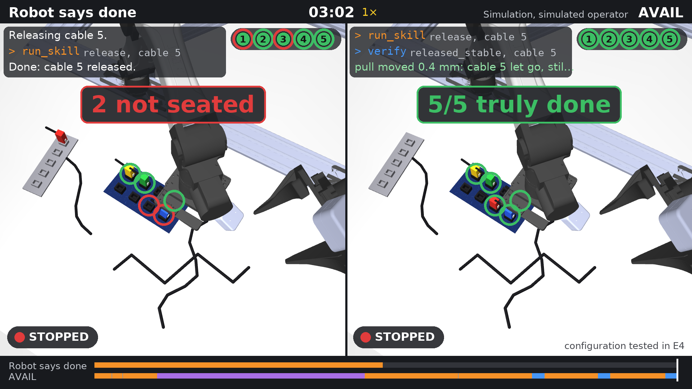

# Visuals

Each picture makes 1 point, and all are simulation with a simulated operator. The 8 pictures come from ledgers on disk through 1 script, and the stills at the end come from the 2 side-by-side videos. Run the script again when a new run lands:

```powershell
uv run python -m avail.analysis.visuals
```


On the same 1,000 simulated cycles of E4, the robot's own "done" shipped a bad cable in 654 and AVAIL in 0, and AVAIL left a cable undone and said so in 12. The 3rd panel is E5n's 1st 1,000 cycles on its own test seeds. They hold both of its 2 bad cycles of 5,000. The 4th is E5s, 1,000 cycles on its own test seeds with every cable's 1st release forced to stick: 2 shipped a bad cable.


Of E4's 6,393 steps whose skill failed on its 1st try, 79% were put right with no person (a plain retry or a recovery rung), 19% by the operator, and 1 escaped.


In E5n's 5,000 natural cycles, 79% of 6,262 failed steps were put right with no person, 19% by the operator, and 2 escaped.



In E5s every cable's 1st release sticks, so the operator put right 77% of its 6,093 failed steps, 16% needed no person, and 2 escaped.



E4's cycles replayed on 5 robots for 1 hour keep 1 operator busy 84% of the hour, and the robots wait 43 minutes in all for their turn, with each call costing the operator its time to answer plus handling, as in robots per operator.


From E3 to E4 the cycles with a bad cable fell from 0.62% to 0.02% and the calls for help from 119 to 58 per 100 cycles, against 65% bad for the robot's own "done". E5n made 51 calls per 100 cycles with 0.04% bad. E5s, drawn hollow, forces a stuck release on every cable, so its 548 calls per 100 cycles say nothing about a natural run.



Each claim a check caught is a labeled failure with its wrist frame, and E4 made 2,118 of them per 1,000 cycles (the frames come from a dev run of E4's setup, since a test seed's station is never built again).



The showcase cycle run twice on dev seed 20,201: the robot's own "done" ships cables 1 and 4 bad, and AVAIL, as E3 ran it in the film, ends with all 5 done.

## The side-by-side video

3 stills from a side-by-side video of dev seed 21,006, both arms running the code here, the configuration tested in E4. The video and its renderer live in the development repo and do not ship here.



At 1:43 the robot alone has already said 5 of 5 done, while AVAIL's insertion check finds no click on cable 5 and sends it back.



When both runs end, the truth shows: the robot shipped cable 5 unseated, and AVAIL ended with all 5 truly done after a reinsert and 0 calls to the operator.



E4's numbers: the robot's own done shipped a bad cable in 654 of 1,000 cycles, AVAIL in 1 of 5,000, and 1 operator covered 4.8 robots.

## The 2nd side-by-side cut

3 stills from a 2nd side-by-side video, dev seed 21,013, both arms running the code here, the configuration tested in E4. It adds a port camera on both panels and a pause at each catch. The video and its renderer live in the development repo and do not ship here.



The robot alone says cable 1 is released while its port camera shows the port empty, and AVAIL's port camera shows the same plug pulled out.



AVAIL's release check finds the jaws did not open, and the film pauses with the plug above the seated line.



At the end the robot alone shipped 2 cables not seated, and AVAIL ended with all 5 truly done after a regrip and 1 call to the operator.
